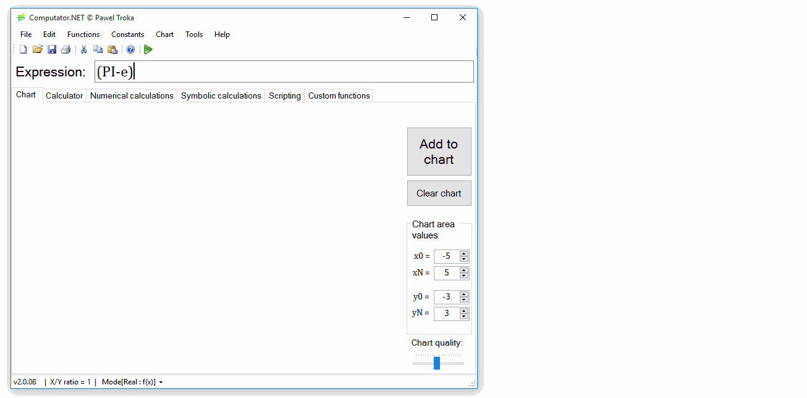

# 

Computator.NET is open-source numerical software for exploring mathematics through calculations, charts and scripts.



It includes real, complex and two-variable function charts and calculations; numerical integration, derivatives and root finding; elementary, special and matrix functions; and the original TROKA Scripting Language (TSL), custom functions and mathematical notation.

## Developing the 2026 migration

**This branch is a compatibility migration, not a new certified release.** The desktop and mathematical API target **.NET Framework 4.8.1**, built with the **.NET 10 SDK and C# 14**. The independent web-client host targets **ASP.NET Core 10**, with **React 19, TypeScript 7 and Vite 8**. These are deliberately different runtime boundaries.

Read [the migration and verification guide](docs/MIGRATION-2026.md) before upgrading an existing installation. The old Windows XP, Mono, MSI bootstrapper and Visual Studio 2017 Coded UI build paths are **not** supported by the new solution; see [legacy tooling](docs/LEGACY-TOOLING.md).

### Windows development

Install the SDK pinned by `global.json` and .NET Framework 4.8.1. Use a current Visual Studio installation supporting this SDK and the desktop workload, or the command line. Reference assemblies are restored from NuGet; an old manually installed 4.6.1 targeting pack is not required.

```powershell
dotnet restore Computator.NET.sln --locked-mode
dotnet build Computator.NET.sln -c Release --no-restore
# Build, test all active suites and verify portable output:
pwsh ./build/Validate-Migration.ps1
```

`Computator.NET.Modern.slnx` contains the same active projects, organized by area. Use an explicit solution filename because both solution formats are present. Generated dependency graphs are checked in; intentional upgrades update `Directory.Packages.props` and the affected lockfiles together.

### Web-client development

Use the Node LTS version in `.nvmrc` and the npm version in `Computator.NET.WebClient/package.json`.

```sh
cd Computator.NET.WebClient
npm ci
npm run dev
```

The Vite development UI runs at `http://127.0.0.1:5173`. Start the mathematical API separately **on Windows**:

```powershell
dotnet run --project Computator.NET.WebApi -- --urls http://localhost:60996
```

The default API address remains `http://localhost:60996/api`. Copy `.env.example` to `.env.local` to override the build-time address. The web client's static assets and ASP.NET Core 10 host can be built on Linux or macOS; the mathematical API still requires the Windows desktop libraries.

```sh
# From Computator.NET.WebClient:
npm run build
npx playwright install chromium firefox
npm test
dotnet publish -c Release -o ../artifacts/webclient
```

Publishing runs `npm ci` and the production build automatically. CI tests the published ASP.NET host, not just Vite's development server.

**Security:** TSL executes trusted code with the application's permissions. It is not a sandbox. Keep the mathematical API on loopback and do not expose its anonymous scripting endpoints to the Internet. CORS is not authentication and does not make script execution safe.

## Verification

The GitHub Actions workflows build and test Windows code, run the numerical integration suite, exercise API routes, check desktop startup/resources, and test the production web client in Chromium and Firefox. They retain test results and failure traces. A portable CI artifact is a **migration candidate**, not an installer-certified release.

The release checklist in [MIGRATION-2026.md](docs/MIGRATION-2026.md) also requires real-machine checks for saved settings, scripts, chart rendering, editor switching and deployment. Automated test success does not replace these checks.

## Existing release: 2.3.2

The historical 2.3.2 packages are separate from this migration:

- [Release notes and downloads](https://github.com/PawelTroka/Computator.NET/releases/tag/v2.3.2)
- [Installer](https://github.com/PawelTroka/Computator.NET/releases/download/v2.3.2/Computator.NET.Installer.v2.3.2.exe)
- [Portable ZIP](https://github.com/PawelTroka/Computator.NET/releases/download/v2.3.2/Computator.NET.v2.3.2.zip)
- [Historical Windows XP ZIP](https://github.com/PawelTroka/Computator.NET/releases/download/v2.3.2/Computator.NET.v2.3.2-WindowsXP.zip)

Those packages retain their original framework requirements. Do not use the old installer to deploy newly built 4.8.1 binaries.

## Working with Computator.NET

To write in an exponent, use **Shift+6 (`^`)**, or the corresponding command in the Edit menu.


For numerical equation solving, use the **Numerical calculations** tab and **Function root** operation. Different methods suit different equations. Graphical solutions are also possible by inspecting function intersections.


## Contributing

Use a fork and pull request. Include regression tests for behavior changes and review dependency lockfile changes. Report reproducible bugs in [Issues](https://github.com/PawelTroka/Computator.NET/issues); the [TODO file](TODO) contains additional project ideas.

## License

Computator.NET is distributed under [GNU GPL v3](LICENSE). Third-party dependencies retain their own licenses; review their notices when distributing a new build.
