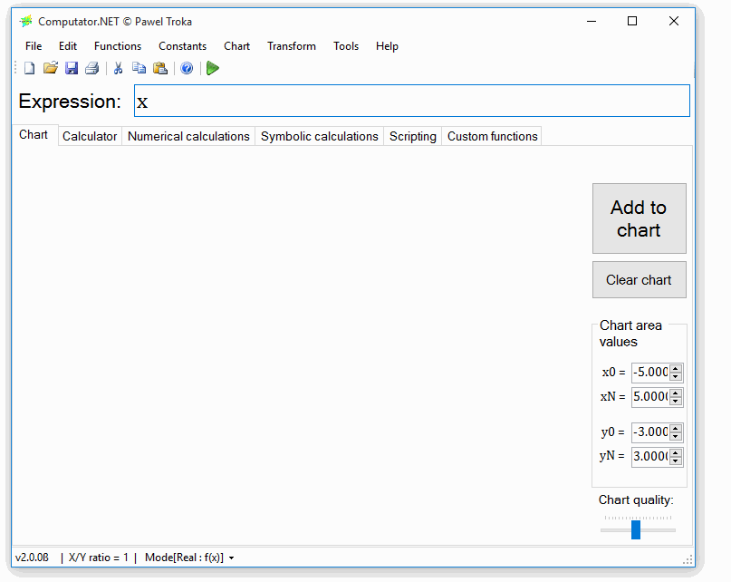

<p align="center">
  
</p>

# Mathematics you can calculate, plot and program

**Computator.NET** is open-source numerical software with a Windows desktop, a browser workspace and a portable scientific CLI. Work with real and complex functions, explore charts, and write mathematical expressions and scripts in **TROKA Scripting Language (TSL)**.

[**Get started**](#get-started) · [**Rider and development**](docs/DEVELOPING.md) · [**Build and test**](docs/BUILD.md) · [**Documentation**](docs/README.md) · [**Contribute**](CONTRIBUTING.md)

[](https://github.com/PawelTroka/Computator.NET/actions/workflows/solution.yml)
[](https://github.com/PawelTroka/Computator.NET/actions/workflows/portable.yml)
[](https://github.com/PawelTroka/Computator.NET/actions/workflows/webclient-validation.yml)

## Choose your workspace

| Workspace | What you can do | Where it runs |
| --- | --- | --- |
| **Windows desktop** | Real, complex and 3D charts; the full built-in function reference; numerical methods; custom functions and script documents | .NET 10, WinForms and WPF on Windows |
| **Web workspace** | Calculate, run scripts, integrate and render charts through the mathematical API; edit and import/export custom functions | The frontend host is cross-platform; the full mathematical API runs on Windows |
| **Portable CLI and engine** | Evaluate TSL, use managed matrix functions, integrate, differentiate, find roots and run scripts with JSON results | .NET 10 on Windows, Linux and macOS |
| **Reduced Mono desktop** | The explicit compatibility build with the legacy TextEditor and Unix 2D/complex charts | Experimental; see the [Mono guide](docs/MONO-DESKTOP.md) for tested environments and limitations |

The source tree's candidate identity is defined in [Version.props](Version.props). For downloadable builds, use [Releases](https://github.com/PawelTroka/Computator.NET/releases); for candidate readiness, use the [release checklist](docs/RELEASE-3.0.md). A successful build is one part of release acceptance.

## Get started

Clone the repository and run the commands below **from its root**:

```sh
git clone https://github.com/PawelTroka/Computator.NET.git
cd Computator.NET
```

Install the SDK selected by [global.json](global.json) and **PowerShell 7** for Cake validation helpers. For web work, also select Node from [.nvmrc](.nvmrc) and npm from [package.json](Computator.NET.WebClient/package.json). [Prerequisites by task](docs/DEVELOPING.md#prerequisites) keep native-build and packaging tools separate from the everyday edit loop.

For a quick command menu before installing the toolchain, run `./build.ps1 -Help` in PowerShell or `./build.sh --help` in Bash. This help is available offline, without an SDK, Cake or package restore.

### Windows desktop

Open **[Computator.NET.slnx](Computator.NET.slnx)** in Rider or Visual Studio, select `Computator.NET`, and run it. The same solution contains the engine, web applications, CLI, tests and tools.

```powershell
./build.ps1 -Target Build -Configuration Debug
dotnet run --project Computator.NET --configuration Debug --no-build
```

For a disposable settings profile, use the [development profile recipe](docs/DEVELOPING.md#run-and-debug). [Rider setup](docs/DEVELOPING.md#rider-workflow) covers project navigation, launch profiles, test discovery and focused debugging.

### Portable CLI: Windows, Linux and macOS

Try the managed engine directly with the pinned SDK:

```sh
dotnet run --project Computator.NET.Cli -- calculate --expression '2x+3' --x 7
dotnet run --project Computator.NET.Cli -- integrate --expression 'x*x' --a 0 --b 3 --steps 100
dotnet run --project Computator.NET.Cli -- root --expression 'x*x-2' --a 0 --b 2
```

The first command returns `{"result":"17"}`; the integral is approximately `9`, and the root is approximately `1.41421356237`. See the [CLI guide](docs/followups/PORTABLE-ENGINE.md) for all six commands, custom-function files, JSON errors and the portable function boundary.

### Web development

On Windows, run the two source projects in separate terminals, or select their launch profiles in Rider:

```powershell
# Terminal 1: mathematical API
dotnet run --project Computator.NET.WebApi --launch-profile Computator.NET.WebApi

# Terminal 2: frontend host; prepares source assets through Cake
dotnet run --project Computator.NET.WebClient --launch-profile Computator.NET.WebClient
```

Use the listening addresses from the run output; project-owned [API](Computator.NET.WebApi/Properties/launchSettings.json) and [frontend](Computator.NET.WebClient/Properties/launchSettings.json) profiles define them. For Vite hot reload, run `npm ci` and `npm run dev` in `Computator.NET.WebClient`, with the API running separately. [Web development](docs/WEB-DEVELOPMENT.md) explains the two modes and asset preparation.

The source profiles use API `http://localhost:5080` and frontend `http://localhost:5081`. The Vite UI runs at `http://127.0.0.1:5173`, with compatibility API default `http://localhost:5080/api`. Cake selects the pinned Node/npm tools for source preparation and frontend builds; direct `npm` commands use your shell's tools. Direct `dotnet publish` of the frontend host also delegates frontend compilation to Cake.

For a complete browser-facing package, [Local-Web-Package](docs/LOCAL-WEB-PACKAGE.md) stages both hosts, their runtime and the protected local launcher.

## Build and test with one task graph

[Cake](build.cake) owns restore, builds, validation and packaging. The wrappers restore the repository's [pinned local Cake tool](.config/dotnet-tools.json); no global Cake installation is needed.

| Task | Windows PowerShell | Bash |
| --- | --- | --- |
| Check solution links and project visibility | `./build.ps1 -Target Solution-Check` | `./build.sh --target=Solution-Check` |
| Full solution build | `./build.ps1 -Target Build` | Windows graph; use the portable/web targets below on other systems |
| All four Windows test suites | `./build.ps1 -Target AllTests` | Requires Windows |
| Portable tests and published CLI smoke checks | `./build.ps1 -Target Portable-Validate` | `./build.sh --target=Portable-Validate` |
| Frontend, host and focused browser checks | `./build.ps1 -Target Web-Validate` | `./build.sh --target=Web-Validate` |
| Actual browser-to-API workflows | `./build.ps1 -Target Web-E2E` | Requires Windows |

Cake defaults to **Release**; `dotnet build`, `dotnet test` and Rider commonly use **Debug**. Keep configurations consistent when reusing outputs. `AllTests` covers the four Windows suites; portable and browser checks have their own targets. [The build guide](docs/BUILD.md) lists focused targets, coverage, output paths and the wider release gates.

## Explore the code and documentation

| I want to… | Start here |
| --- | --- |
| Find a project, fix missing Rider items, or run one test | [Developer guide](docs/DEVELOPING.md) |
| Understand CLI commands and portable capabilities | [Portable engine and CLI](docs/followups/PORTABLE-ENGINE.md) |
| Change the parser or mathematical notation | [TSL and engine source](Computator.NET.Engine/Computator.NET.Engine.csproj), [function powers](docs/FUNCTION-POWERS.md) |
| Improve built-in function help and illustrations | [Reference authoring](docs/FUNCTION-REFERENCE.md), [equations and diagrams](docs/REFERENCE-EQUATIONS.md) |
| Investigate startup or execution performance | [Performance guide](build/performance/README.md), [measured issue #191 investigation](docs/performance/issue-191/README.md) |
| Build a distribution or review migration evidence | [Release preparation](docs/RELEASE-3.0.md), [documentation directory](docs/README.md) |

Dependencies are reviewed through [central NuGet versions](Directory.Packages.props) and the frontend's single [npm lockfile](Computator.NET.WebClient/package-lock.json). Normal Windows publishing stages the pinned **GSL 2.8** payload, source material and provenance; development outputs without that payload retain the embedded fallback. See [dependency policy](docs/BUILD.md#dependency-policy-one-frontend-lockfile-not-twelve-nuget-graphs) and [native distribution behavior](docs/followups/GSL-ADOPTION.md).

## A few desktop interactions

Use **Shift+6 (`^`)** or the Edit menu to enter an exponent. For numerical equation solving, choose **Numerical calculations → Function root**; graphical solutions can also be explored through function intersections.

<details>
<summary>Watch the original desktop demonstrations</summary>

These recordings illustrate the interactions; their appearance predates the current builds.




</details>

## Contribute

Start with [CONTRIBUTING.md](CONTRIBUTING.md): check existing work, reproduce the problem, choose the relevant tests and open a focused PR. Report bugs with reproduction steps in [Issues](https://github.com/PawelTroka/Computator.NET/issues), and check older requests against current functionality before starting an implementation.

**Execution model:** TSL runs trusted code with the application's permissions. Keep local web hosts on loopback; access tokens, limits and process workers do not turn arbitrary scripts into a public multi-user sandbox. [Execution policy](docs/SHARED-EXECUTION-POLICY.md) and [worker lifetime](docs/followups/EXECUTION-WORKERS.md) describe the boundaries.

Computator.NET is licensed under **[GNU GPL v3](LICENSE)**. Third-party dependencies retain their own licenses and distribution requirements.
