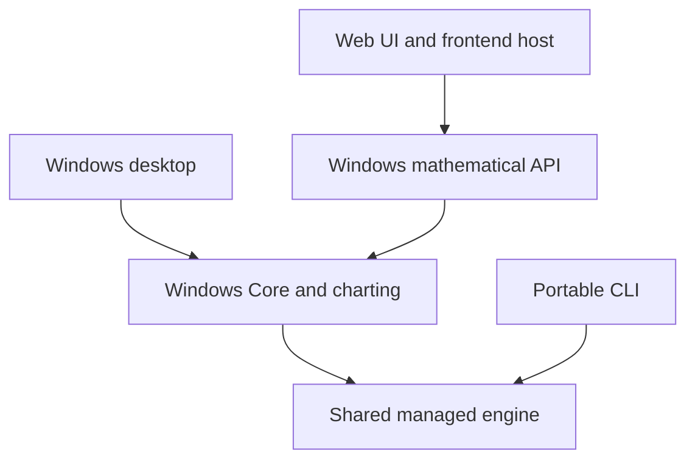

# Develop Computator.NET

[Overview](../README.md) · [Documentation](README.md) · [Build target reference](BUILD.md) · [Contributing](../CONTRIBUTING.md)

Open **[Computator.NET.slnx](../Computator.NET.slnx)**. It is the single solution for the desktop, shared engine, CLI, web applications, tests and tools. Use project-level runs for the edit/debug loop and Cake targets for the repository's validation and packaging contracts.

**On this page:** [Prerequisites](#prerequisites) · [Rider workflow](#rider-workflow) · [Run and debug](#run-and-debug) · [Test workflow](#test-workflow) · [Project map](#project-map) · [Troubleshooting](#troubleshooting)

## Prerequisites

| Work you are doing | Install/select | Source of truth |
| --- | --- | --- |
| Any modern .NET project | The SDK requested by `global.json`, with its declared patch roll-forward policy | [global.json](../global.json) |
| Cake validation | PowerShell 7 (`pwsh`), Git and the SDK; the wrapper restores Cake locally | [.config/dotnet-tools.json](../.config/dotnet-tools.json), [build.cake](../build.cake) |
| Windows desktop/API and their four test suites | Windows and the modern .NET desktop/ASP.NET development runtimes supplied with the SDK; Framework support for the legacy fixture/installer tools | [ModernDesktop.props](../build/ModernDesktop.props), [BUILD.md](BUILD.md) |
| Frontend assets or browser tests | Node selected by `.nvmrc` and npm selected by `packageManager`; engine requirements are checked | [.nvmrc](../.nvmrc), [package.json](../Computator.NET.WebClient/package.json), [.npmrc](../Computator.NET.WebClient/.npmrc) |
| Native GSL or Windows publication | Python 3.11+, Git and the host's C++ toolchain (Visual Studio C++ build tools on Windows); the pinned native build supplies its CMake/CTest tools | [Native build guide](followups/GSL.md), [build guide](BUILD.md) |
| MSI/MSIX or Mono compatibility | The additional tools for that explicit target | [Installer](followups/INSTALLER.md), [MSIX](followups/MSIX.md), [Mono](MONO-DESKTOP.md) |

The native/installer toolchain is not required for an ordinary desktop solution build. `CI`, publication and distribution targets do more than compile; check their dependencies before choosing one as your inner loop.

From the repository root, confirm which tools your shell sees:

```sh
dotnet --version
dotnet --info
pwsh --version
git --version
# For web work:
node --version
npm --version
```

Run the SDK check from inside the checkout so `global.json` participates in selection. Restart Rider after installing or changing tools: its existing process can retain an older `PATH`.

For an offline recipe menu, use `./build.ps1 -Help` or `./build.sh --help`; neither command needs the SDK or restores packages. After installing the SDK, `--description` lists actual Cake targets, `--tree` shows the whole task graph, and `--target=Portable-Validate --dryrun` plans that target without running its setup or tasks. See [build discovery](BUILD.md#commands) for both shell forms.

## Rider workflow

### Open and navigate

1. Open `Computator.NET.slnx` with a Rider version supporting the repository's SDK and SLNX format.
2. Let project restore finish. In **Settings → Build, Execution, Deployment → Toolset and Build**, check the selected .NET CLI/MSBuild if Rider disagrees with your terminal.
3. Use the Explorer's **Solution** view for the project model and linked solution items. Use **File System** view or **Show All Files** to inspect physical files, including generated output.
4. Follow the [project map](#project-map) to the executable, test suite or build tool you need. Build/CI files and documentation belong to solution folders, while imported source links belong to their consuming C# projects.

The solution's logical folders do not move files on disk. A linked file is the same physical source, not a second copy. For example, the engine compiles TSL handlers from `Computator.NET.Core/Compilation` and mathematical sources from their existing Core directories; the Windows application consumes that shared assembly.

Rider documents the distinction between the [Solution and File System views](https://www.jetbrains.com/help/rider/Project_Tool_Window.html). `Show All Files` is useful for diagnosis; it does not add an item to a project or change what MSBuild compiles or publishes.

### Build only what you need

On Windows, **Build Solution** builds the complete supported project inventory. To work on one application, build/run that project and its references. Select the matching test project when testing a change. This avoids rebuilding unrelated tools during every edit.

On Linux/macOS, keep the same solution open for navigation and build the portable or frontend projects. Full-solution restore/build includes WinForms/WPF and Framework tools; it is a Windows graph. Use `Portable-Validate` or `Web-Validate` for the corresponding cross-platform checks.

Building `Computator.NET.Installer` compiles the authoring tool. Running that executable is a separate packaging operation. Native probes also need the arguments supplied by their dedicated validation targets.

### Import launch profiles

The web projects own their profiles in `Properties/launchSettings.json`. Rider can generate **.NET Launch Settings Profile** configurations from them. If an existing workspace did not import them, right-click the relevant `launchSettings.json` and choose **Generate Configurations**, then select the profile on the toolbar. See [JetBrains' launch-profile guide](https://www.jetbrains.com/help/rider/Running_LaunchSettings.html).

Use **.NET Project** configurations for the desktop and CLI. For the CLI, put `calculate --expression "2x+3" --x 7` in the program arguments. Keep personal paths, secrets and local profile choices out of shared configuration files.

## Run and debug

| Application | Startup project | Platform and setup |
| --- | --- | --- |
| Desktop | `Computator.NET` | Windows; use a disposable data directory when testing settings migration |
| Mathematical API | `Computator.NET.WebApi` | Windows; use its Development launch profile |
| Web frontend host | `Computator.NET.WebClient` | Source assets are prepared through Cake; calculations need the Windows API |
| Portable scientific CLI | `Computator.NET.Cli` | Windows/Linux/macOS; supply command arguments or `--help` |

### Desktop with a disposable profile

In a dedicated PowerShell terminal:

```powershell
$env:COMPUTATOR_DATA_DIRECTORY = Join-Path ([IO.Path]::GetTempPath()) ('Computator-Dev-' + [Guid]::NewGuid())
dotnet run --project Computator.NET --configuration Debug
```

For Rider debugging, set `COMPUTATOR_DATA_DIRECTORY` to a new disposable directory in that desktop run configuration. Keep your real settings/documents backed up for migration trials. Cake creates its own temporary profile and restores the caller's environment afterward.

### Web applications

Start the API and frontend as two debug/run configurations. The frontend does not silently launch a second source API. The current addresses and Development environment settings live in the [API profile](../Computator.NET.WebApi/Properties/launchSettings.json) and [frontend profile](../Computator.NET.WebClient/Properties/launchSettings.json).

The equivalent commands, in separate terminals on Windows, are:

```powershell
dotnet run --project Computator.NET.WebApi --launch-profile Computator.NET.WebApi
dotnet run --project Computator.NET.WebClient --launch-profile Computator.NET.WebClient
```

The source frontend runs Cake `Web-Build` if its prepared assets are missing or changed. Watch the run console on first launch; a frontend install/build failure stops startup. For frontend hot reload, use `npm run dev` in the web-client directory after `npm ci`. See [WEB-DEVELOPMENT.md](WEB-DEVELOPMENT.md) for source startup and [LOCAL-WEB-PACKAGE.md](LOCAL-WEB-PACKAGE.md) for the packaged launcher.

### Portable CLI

```sh
dotnet run --project Computator.NET.Cli -- --help
dotnet run --project Computator.NET.Cli -- calculate --expression '2x+3' --x 7
```

These direct commands need the SDK and restored project dependencies. [Portable-Validate](followups/PORTABLE-ENGINE.md#build-and-run) additionally runs the engine tests, publishes the CLI and verifies its process/JSON contracts.

## Test workflow

### Choose the right suite

| Test project | Main responsibility | Execute on | Cake target |
| --- | --- | --- | --- |
| `Computator.NET.Engine.Tests` | Shared TSL, portable evaluation/numerics and source-linked portable regressions | Windows/Linux/macOS | `Portable-Test`; `Portable-Validate` also checks the published CLI |
| `Computator.NET.Core.Tests` | Windows Core/compiler/function behavior and settings migration | Windows | `CoreTests` |
| `Computator.NET.Desktop.Tests` | Real desktop controls, editors, presenters and rendering | Windows | `DesktopTests` |
| `Computator.NET.Core.IntegrationTests` | Scientific/numerical functions against production implementations | Windows | `CoreIntegrationTests` |
| `Computator.NET.WebApi.IntegrationTests` | API execution, transport, access and worker contracts | Windows | `ApiTests` |

`UnitTests` selects Core + Desktop; `IntegrationTests` selects numerical + API; `AllTests` selects all four Windows suites. Browser suites and the portable suite are separate. The retired `Computator.NET.Desktop.UITests` project is historical Coded UI source; it is not the current desktop test suite.

### Fast local loop

Run one portable compiler fixture while editing the shared language code:

```sh
dotnet test Computator.NET.Engine.Tests/Computator.NET.Engine.Tests.csproj --configuration Debug --filter 'FullyQualifiedName~TslCompilerTests'
```

On Windows, choose a corresponding test project or fixture through Rider. Open **View → Tool Windows → Unit Tests**, build that test project, and group/filter by project or fixture. Tests in unopened files may not appear until the project has built. If metadata discovery misses parameterized cases, Rider offers **Test runner** discovery under its NUnit settings. [JetBrains documents both discovery modes](https://www.jetbrains.com/help/rider/Unit_Testing_in_Solution.html).

A direct `dotnet test` or Rider run is convenient for focused debugging. Cake also prepares the legacy settings fixture, isolates the profile, writes TRX and applies discovery/skip guards. Use the relevant Cake suite to establish repository validation after the fast loop:

```powershell
./build.ps1 -Target CoreTests -Configuration Debug
./build.ps1 -Target AllTests -Configuration Release
```

```sh
./build.sh --target=Portable-Test --configuration=Debug
./build.sh --target=Portable-Validate
```

Cake defaults to Release. Direct SDK commands default to Debug unless a configuration is supplied. Use `--no-build` only when the matching project, framework and configuration have already built successfully.

### Web checks

| Target | What it exercises |
| --- | --- |
| `Web-Build` | Locked npm install/audit, strict TypeScript and production frontend assets |
| `Web-Validate` | Published frontend host and Chromium/Firefox tests using mocked mathematical API responses |
| `Web-IDE-Validate` | Windows source-project startup, prepared assets and actual API calculations |
| `Web-E2E` | Published hosts, protected proxy and actual mathematical API workflows on Windows |
| `Web-CustomFunctions` | Actual API workflows for custom definitions on Windows |
| `Local-Web-Validate` | The unpacked self-contained local-web package and its owned API |

Run suites that share fixed local ports sequentially. A focused mocked-API pass does not exercise the mathematical backend. [BUILD.md](BUILD.md) and the [web guides](README.md#application-behavior-and-architecture) explain the evidence each target produces.

## Project map

The main execution paths are:



| Area | Projects or paths | Purpose |
| --- | --- | --- |
| Desktop | `Computator.NET`, `Computator.NET.Desktop`, `Computator.NET.Charting` | Executable composition, controls/presenters and chart rendering |
| Shared engine | `Computator.NET.Engine` | TSL transformation, portable compilation and shared managed numerical/matrix sources |
| Windows services | `Computator.NET.Core`, `Computator.NET.DataTypes`, `Computator.NET.Localization` | Full function catalog, evaluation, data/UI contracts and resources |
| Applications | `Computator.NET.Cli`, `Computator.NET.WebApi`, `Computator.NET.WebClient` | Console protocol, mathematical HTTP service and React/Vite frontend host |
| Tests | The five projects in the [test map](#choose-the-right-suite) | Portable, Core, desktop, numerical and API coverage |
| Build graph | `build.cake`, `build/followups/*.cake`, root wrappers | Shared task orchestration |
| Developer tooling | `build/reference`, `build/performance`, `build/native`, `build/acceptance` | Reference authoring, measurements, native checks and distribution acceptance |
| Distribution tools | `Computator.NET.Installer`, `build/msix`, `build/local-web` | Installer authoring, MSIX and protected local-web packaging |

The [Engine project file](../Computator.NET.Engine/Computator.NET.Engine.csproj) is the exact source-link map. Shared TSL handlers and numerical implementations remain in their original physical directories and compile into the engine. Windows Core forwards their original public type identities. When modifying an implementation, check its consumers and any emitted `ToCode` counterpart before choosing tests.

Keep every supported project in the canonical solution. The old XP launcher/Coded UI projects remain linked as historical files, and the active Mono probes belong to the explicit compatibility graph. `Solution-Check` checks the inventory, linked files and evaluated project items on any supported host, without restoring/building application projects or preparing a Windows test profile. It requires the SDK, Git and PowerShell; the wrapper restores Cake itself. The full `Solution-Validate` target additionally builds every supported project and therefore requires Windows.

```sh
./build.sh --target=Solution-Check
# PowerShell equivalent: ./build.ps1 -Target Solution-Check
```

For only the tracked-file inventory, invoke [Assert-Solution.ps1](../build/Assert-Solution.ps1) directly with `pwsh -NoProfile -File build/Assert-Solution.ps1`.

## Troubleshooting

| Symptom | Check and next action |
| --- | --- |
| Rider cannot load SLNX or selects the wrong SDK | Confirm your Rider release supports the SDK/format, open the root SLNX, compare `dotnet --info` with Toolset and Build settings, then restart after tool/PATH changes |
| A file is visible on disk but missing from Solution view | Inspect File System/Show All Files, then the project's evaluated item or SLNX link; a removed `Content` item is not restored by merely updating a nonexistent `None` item |
| Unit Tests is empty or incomplete | Build the intended test project, inspect restore/build errors, and check NUnit discovery mode; Windows test assemblies need a Windows runtime |
| Full build fails on Linux/macOS | Choose `Portable-Validate` or `Web-Validate`; the root solution includes Windows desktop and Framework tools |
| WebClient fails during `npm ci` or asset preparation | Compare the process's Node/npm versions with the checked-in manifests, install/select them and restart the IDE; preserve the actual build error |
| Web API/frontend fails to bind an address | Inspect the launch profile, listener output and existing processes; use the coordinated endpoint guidance in [web development](WEB-DEVELOPMENT.md) |
| A focused Core test reports a missing legacy fixture | Run the Cake suite, which generates the fixture and sets `COMPUTATOR_LEGACY_FIXTURE` |
| Tests reused stale binaries | Match Debug/Release and rebuild before adding `--no-build`; inspect `TestResults` for this run's reports |
| NuGet auditing or `npm audit` fails | Investigate the reported advisory or feed/connectivity failure; do not silently disable repository auditing |
| Shared assembly version check fails | Follow the `Version.props`/`SharedAssemblyInfo.cs` diagnostic and [release identity guide](RELEASE-IDENTITY.md) |

For a report, capture the base commit, exact command, operating system and the first relevant error. The [build guide](BUILD.md#outputs-and-diagnostics) shows where to find build logs, test reports and generated artifacts.
