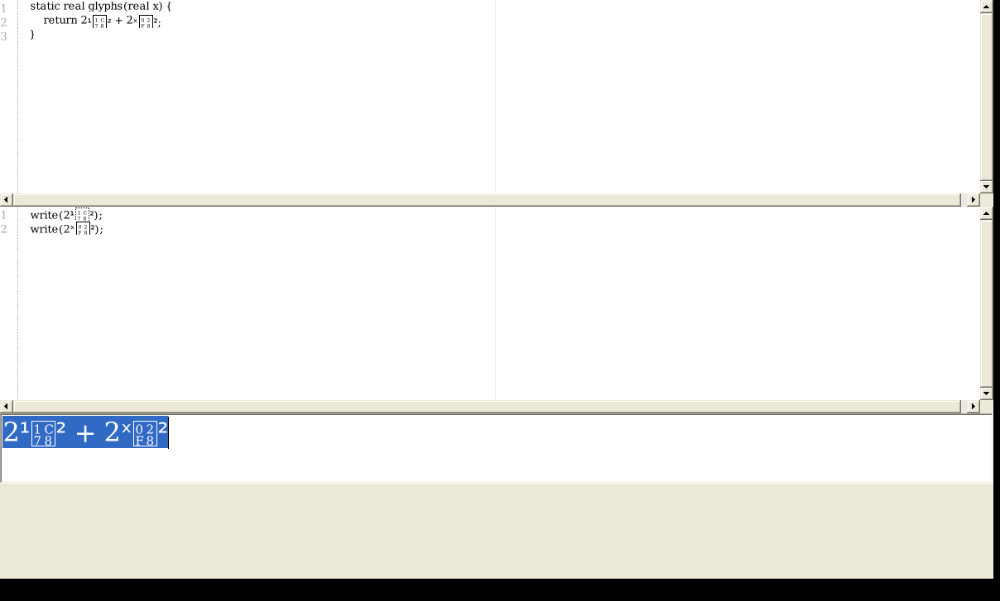
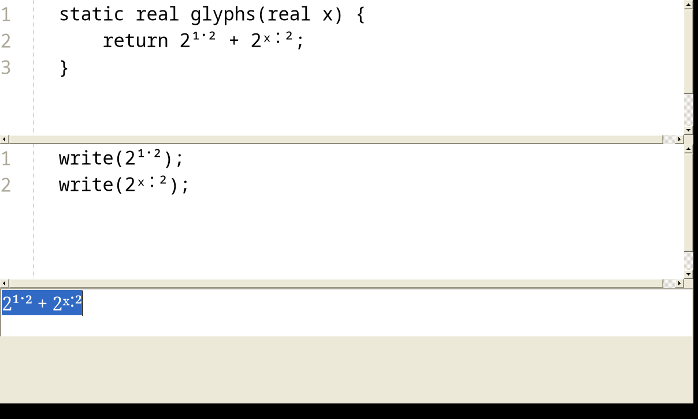

# Mono mathematical glyph regression — 15 November 2026

Issue [#325](https://github.com/PawelTroka/Computator.NET/issues/325) shows missing
glyphs for the existing superscript decimal U+1C78 (`ᱸ`) and division U+02F8 (`˸`).
These are captures of the actual expression control and two TextEditor controls
on an authenticated Xvfb display, using stock libgdiplus 6.1. The fixture requests
24 pt for legibility.
The unchanged editor also loses that font size when opening a new document.

| Unchanged `master` (`d3416a5`) | Corrected production assemblies |
| --- | --- |
|  |  |

## Native evidence

The three methods in
[`MonoMathFontTests.cs`](../../../build/mono/SmokeTests/MonoMathFontTests.cs)
and the existing `NumericInputsFitActualFonts` case were compiled unchanged into
a small external test runner and executed against each application's actual
Mono build. The runner selected the application
directory in a fresh AppDomain and reported the loaded production assembly
path; no mathematical, drawing or editor implementation was substituted.
Before WinForms initialization it invoked the new production font-registration
method when present, reflecting the corresponding old/new application startup.
The baseline therefore failed on actual font behavior, not on a missing method.

| Case (same result on stock 6.1 and pinned patched 6.2) | Baseline | Correction |
| --- | --- | --- |
| GDI+ and WinForms TextRenderer glyph rendering | Failed: missing decimal glyph box | Passed |
| Cold saved-font restoration and JSON save/reload | Failed: saved Noto resolves to DejaVu | Passed |
| Actual expression and editor drawing fonts / document switches | Failed: missing decimal glyph box | Passed |
| Existing numeric-control layout and scaling | Passed | Passed |

The corrected cases check Regular, Bold, Italic and BoldItalic, point and pixel
units, font size preservation, the legacy editor's own font cache, new documents,
settings changes and document switches. Explicit custom fonts and saved source
characters are retained. The first case restores saved Noto fonts after generic
GDI+ drawing objects exist, before either default application family has been
constructed. Registration itself has already run at the production startup
boundary; this does not claim that adding fonts after Pango has cached its map
can refresh that map.
The offline font-asset test independently checks SHA-256 provenance and cmap
coverage of every current `SpecialSymbols` constant.

Environment: Debian 13 x64, Mono 6.12.0.199, .NET SDK 10.0.403 for the net48
build and Xvfb. Each before/after pair ran first with Debian's stock libgdiplus
6.1, then with the repository-pinned libgdiplus 6.2 built with Pango and the
existing private-fontmap patch. Source archive, fixtures and patch hashes were
verified against [`gdiplus-source.json`](../../../build/mono/gdiplus-source.json).
A process-specific Mono dllmap selected 6.2 explicitly for that pair.
Temporary Fontconfig configuration exposed only the host's DejaVu directory;
Noto fonts were available solely through production's process-local Fontconfig
registration. Neither stack required a font installation or a system
configuration edit. Each corrected run passed all four targeted cases; each
baseline run passed numeric layout and failed the three font cases.

These are Linux regression results. They do not certify the Ubuntu release
archives, macOS execution, Windows execution, physical input methods or printing.
The cases are included in the shared Mono acceptance suite and required by the
packaged-evidence guard so those platform lanes exercise them too.
