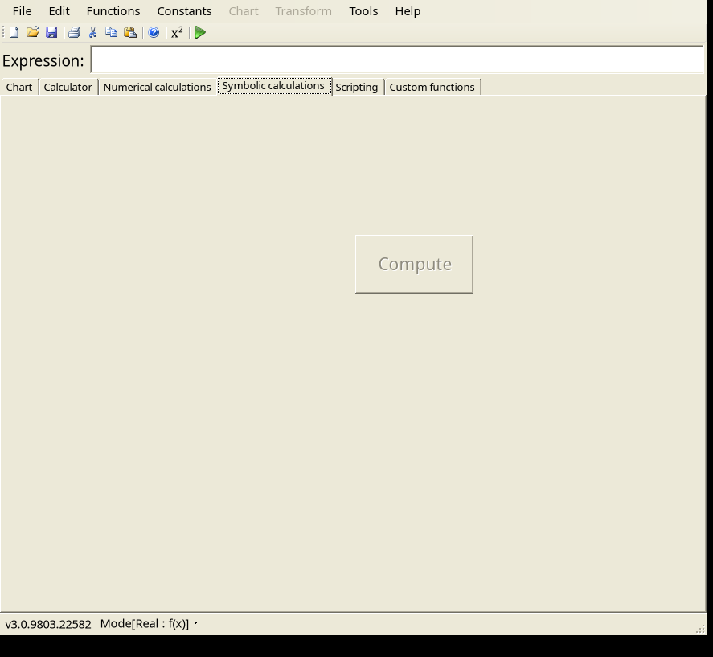
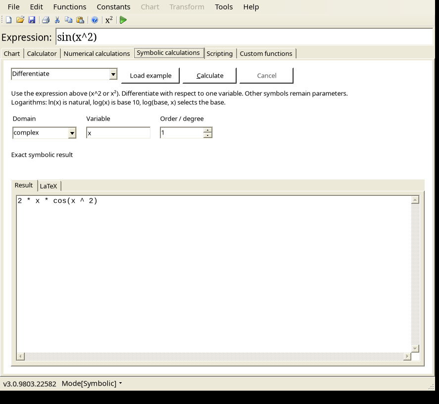

# Native symbolic tab evidence

These are actual visible Linux/Mono application captures from 22 November 2026.
They are not mockups, generated artwork or Windows runtime evidence.

## Before

`before.png` was captured from a separately built, unmodified checkout of
`master` at `d3416a509dcdf03e3fa0daf117241ea97baf7774`. A small capture executable
referenced that checkout's net48 Desktop project, opened the actual composed
`MainView`, selected `ViewName.SymbolicCalculations`, pumped its native events,
and copied the visible window from the screen. The disabled Compute placeholder
is the original application's control.

## After

`after.png` is produced by the committed
`SymbolicCalculationsWorkflowTests.ResultsAndControlsAreRenderedAndKeyboardAccessible`
case. It opens the actual composed MainView, loads the differentiation example,
clicks Calculate, waits for the shared engine and native dispatcher, and reads the
visible screen. The result shown is the derivative of `sin(x²)`.

The source and binary hashes, exact engine dependency and image hashes are in
[provenance.json](provenance.json). The view, presenter and service source files
are hashed individually so the capture remains identifiable after a rebase.

## Environment and executed checks

- Debian 13 x64; .NET SDK 10.0.403 for compilation.
- Unmodified Debian Mono 6.12.0.199, libgdiplus 6.1 and Xvfb 21.1.16, extracted
  into a user-owned runtime prefix. System GSL 2.8 is used by the real desktop
  composition. The symbolic calculations themselves use the shared managed CAS.
- Authenticated Xvfb TCP display, 1600×1100×24. A supported TCP transport is used
  because this execution environment does not permit Unix-domain sockets.
- Both images use `Graphics.CopyFromScreen` after native painting; no
  `DrawToBitmap` fallback is used. Physical hardware, monitor/DPI transitions and
  Windows GUI execution are not claimed.

The three new committed fixture files were source-linked into a temporary
NUnitLite 5.0 net48 runner referencing the actual production Desktop/Core/Engine
projects. This executes their presenter, routing and real-window checks on Mono;
all **27 cases and 232 assertions passed**, with no skipped cases. This is not
the full historical Windows or Mono suite. The raw passing result is
[native-tests.xml](native-tests.xml).

The actual compiled `Computator.NET.Mono.SmokeTests` assembly's
`SymbolicDesktopWorkflow` case was also invoked by a temporary focused runner.
It verified one acknowledged real XTEST Calculate-button click, all 16 operation
examples, toolbar Run, invalid-input recovery, visible capture and normal close.
Its output is [native-smoke.log](native-smoke.log). The complete 56-case package
acceptance pipeline was not executed in this environment.

The normal Windows Desktop.Tests project and the complete Mono application/smoke
project graph were cross-built with zero errors. Native Windows execution remains
for the repository's Windows CI workflow.

The Cake `Solution-Check` target also passed: all linked source/evidence items,
the seven solution-guard rejection scenarios and six evaluated IDE project-item
contracts were verified.
