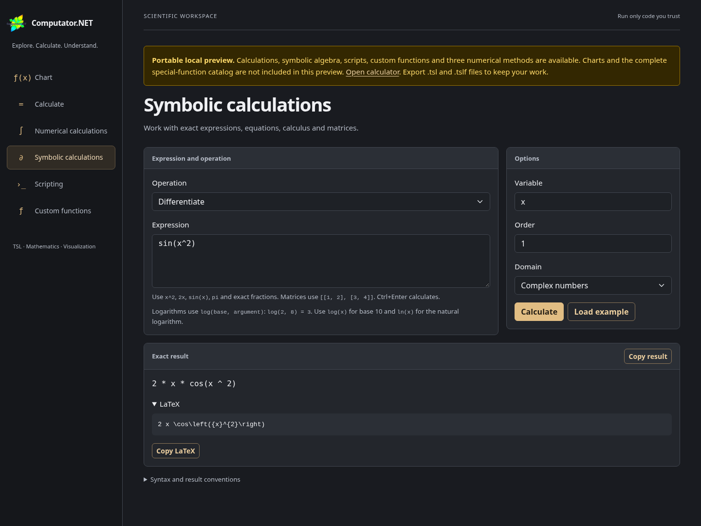
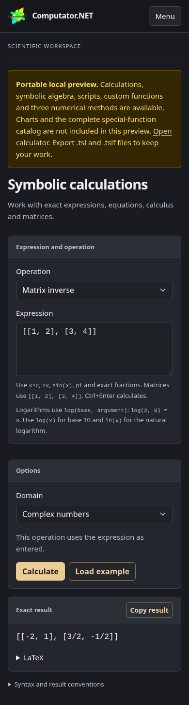

# Symbolic browser workflow — 22 November 2026

These PNGs capture the actual React application. The completed examples use the
published portable host, its isolated child worker and the shared symbolic engine.

## Source and capture identity

| Item | Identity |
| --- | --- |
| Empty-page baseline | Master `d3416a509dcdf03e3fa0daf117241ea97baf7774` |
| Published application source | Local merged snapshot `e341a17a1ac2d0a894bf2f6a4b9295f80dab59fb`, tree `b5bbad404f9bd14efa1e24666163252907430978` |
| Final mathematical implementation | `1615c2c78a7013f1cffa851ec714c9201c84ed08` |
| Review source after the documentation-only base update | `983f966a9de361db3be5d72e0dbe41f961a5d628` |
| Engine PR | [#424](https://github.com/PawelTroka/Computator.NET/pull/424), remote base `217ce6fb05eea19346c81e31f7ae8898ed48f6e5` (same tree as local `720e719`) |
| Runtime | .NET SDK 10.0.403, Linux x64 |
| Browser | Playwright 1.64.1 with official Debian Chromium headless shell 156.0.8078.79 |

The two source snapshots differ only in `docs/SYMBOLIC-CALCULATIONS.md`. Published
assembly SHA-256 values are:

```text
2672724e1811756572c440e044b453cb604eaad1eacee38797cc9650e2293189  Computator.NET.PortableWeb.dll
17d317f6e21e372b6d8476471403b17a170b6ba7b85f21e90402a234f1bb8675  Computator.NET.Engine.dll
```

Both desktop-size captures use a 1440×1080 viewport and the portable capability
notice. The baseline was served from the unchanged master checkout through Vite.
The after capture follows **Differentiate → Load example → Calculate → LaTeX**
against `/api/v2/symbolic`. The mobile capture uses a 390×844 viewport and the
matrix-inverse example. Each full-page capture scrolls normally to the top first,
so fixed navigation retains its actual position. Pixels and page styles are
unchanged.

## Before


## After



## Mobile



## Executed verification

| Check | Result |
| --- | --- |
| Canonical Cake `PortableWeb-Publish` | Passed |
| New real browser/API tests, all sixteen operations | 21 passed |
| New focused UI lifecycle and input tests | 6 passed |
| Complete portable HTTP/process smoke suite | 16 groups passed, including worker deadline, capacity, cancellation and shutdown |
| Windows API integration-test project cross-build | Passed, zero errors; twenty new native API cases compiled |

Browser results above are the local Chromium run. The normal CI configurations
also select Firefox or WebKit where appropriate. Native Windows API execution and
other browser engines were not executed locally. The standard Playwright browser
download returned HTTP 403; the supported Debian headless binary was selected
through a temporary local configuration with the same checked-in test bodies.

See the [browser/API guide](../../followups/SYMBOLIC-WEB.md) for the normal build,
test and request entry points.
