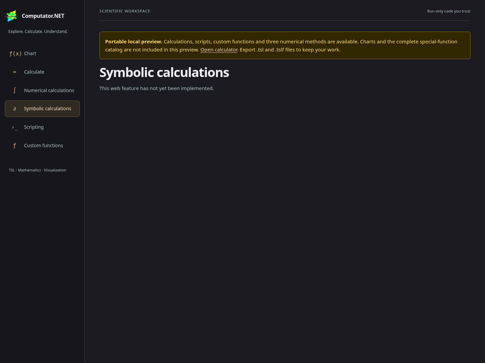

# Symbolic browser workflow — 22 November 2026

These PNGs capture the actual React application. The completed examples use the
published portable host, its isolated child worker and the shared symbolic engine.
The after/mobile captures include the native TSL notation follow-up; the original
empty-page baseline is preserved unchanged.

## Source and capture identity

| Item | Identity |
| --- | --- |
| Empty-page baseline | Master `d3416a509dcdf03e3fa0daf117241ea97baf7774` |
| Published application source | Local merged snapshot `32bda66ef3f5f3e691fe8597078b857d04a7828c`, tree `3d2f136fcf50e3e80935cd6af5440fd792d57283` |
| Final mathematical implementation | `678b86097a7917b8b516446b8c674ffa0d4ce442` |
| Published engine base | [80daf379](https://github.com/PawelTroka/Computator.NET/commit/80daf379bf07f96fba3e543f0433d68fc264e14a), tree `2aa5ce34f90487d83e4aa6cdbe5ea6dbd5e0787d`, identical to the local mathematical implementation |
| Focused UI test source | `7aac62d1b31ca4a2efeb678296d3ffae7787b0c3`; identical frontend source and focused tests to the final snapshot |
| Related PRs | Shared engine [#424](https://github.com/PawelTroka/Computator.NET/pull/424), browser/API [#426](https://github.com/PawelTroka/Computator.NET/pull/426) |
| Runtime | .NET SDK 10.0.403, Linux x64 |
| Browser | Playwright 1.64.1 with official Debian Chromium headless shell 156.0.8078.79 |

The final browser/API tests, HTTP tests and captures use the published application
source above. The focused UI suite passed before the final shared-parser fix;
there were no frontend changes after that run. Published assembly SHA-256 values:

```text
809c0447e29bc44b63def6cee51cfcb925d8e491594491b29ec6a2da7385cb5b  Computator.NET.PortableWeb.dll
887e80d0cfc81b3ecef20c6fc69e099daa87c547df601a20b307a1e4b502127c  Computator.NET.Engine.dll
```

Both desktop-size captures use a 1440×1080 viewport and the portable capability
notice. The baseline was served from the unchanged master checkout through Vite.
The after capture follows **Differentiate → Load example → Calculate → LaTeX**
against `/api/v2/symbolic`. The mobile capture uses a 390×844 viewport and the
compound-power substitution `2·x⁽ⁿ⁺¹⁾` with `x = 2`, `n = 2`, returning `16`.
Each full-page capture scrolls normally to the top first, so fixed navigation
retains its actual position. Pixels and page styles were not modified for capture.

## Before



## After


## Mobile


## Executed verification

| Check | Result |
| --- | --- |
| Canonical Cake `Web-Build` and `PortableWeb-Publish` | Passed |
| Real browser/API tests, all sixteen operations and TSL reuse | 23 passed |
| Focused UI lifecycle, input, caret and copying tests | 8 passed |
| Complete portable HTTP/process smoke suite | 17 groups passed, including worker deadline, capacity, cancellation and shutdown |
| Windows API integration-test project cross-build | Passed, zero errors; twenty-six native symbolic API cases compiled |

The added live regressions were observed failing before their fixes. The original
publication returned `6 * x ^ 2` for the derivative of `2·x³`, and `1/3` for
`log(8,2)`. The first TSL-adapted publication still returned `1/512` for
`sin³(PI/6)²`; the retained regression requires `1/64`. All these cases pass in the
final publication. Derivative and logarithm results are reused unchanged through
both the symbolic endpoint and the ordinary numerical `/api/v2/execute` endpoint.

Browser results above are the local Chromium run. The normal CI configurations
also select Firefox or WebKit where appropriate. Native Windows API execution and
other browser engines were not executed locally. The standard Playwright browser
download returned HTTP 403; the supported Debian headless binary was selected
through a temporary local configuration with the same checked-in test bodies.

See the [browser/API guide](../../followups/SYMBOLIC-WEB.md) for the normal build,
test and request entry points.
