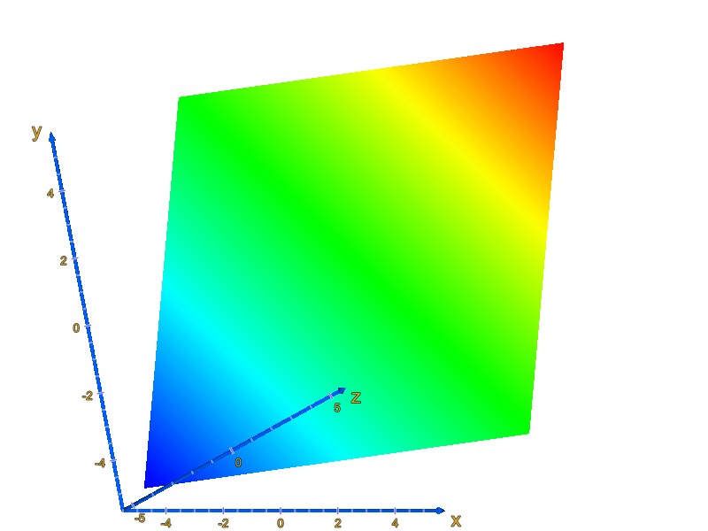
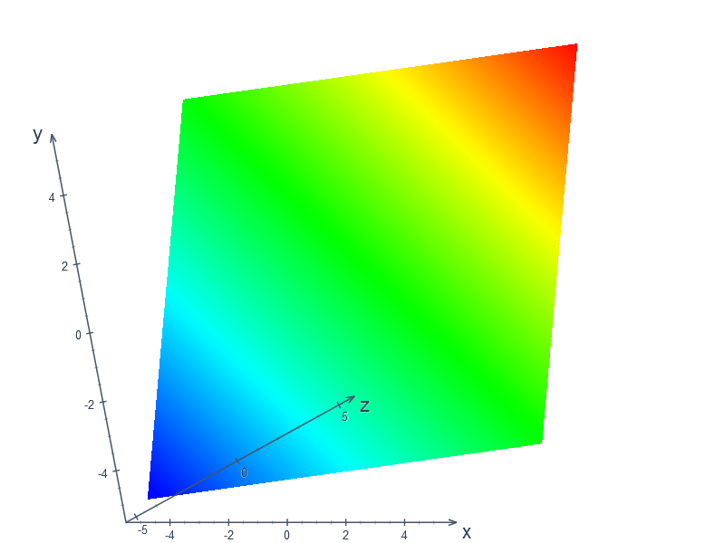
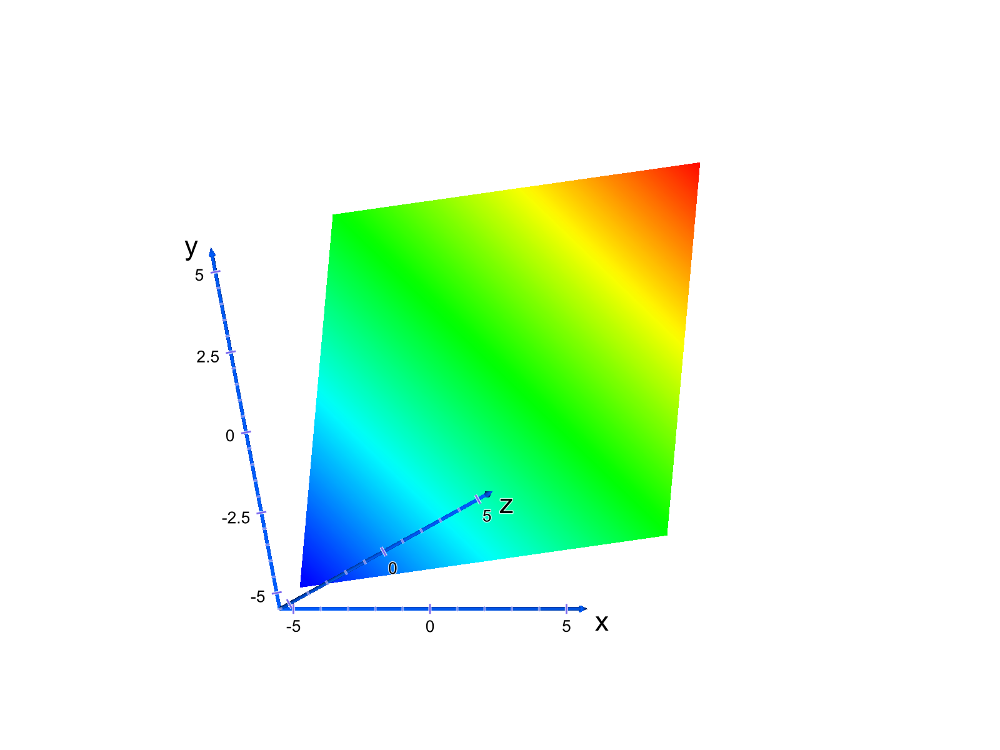
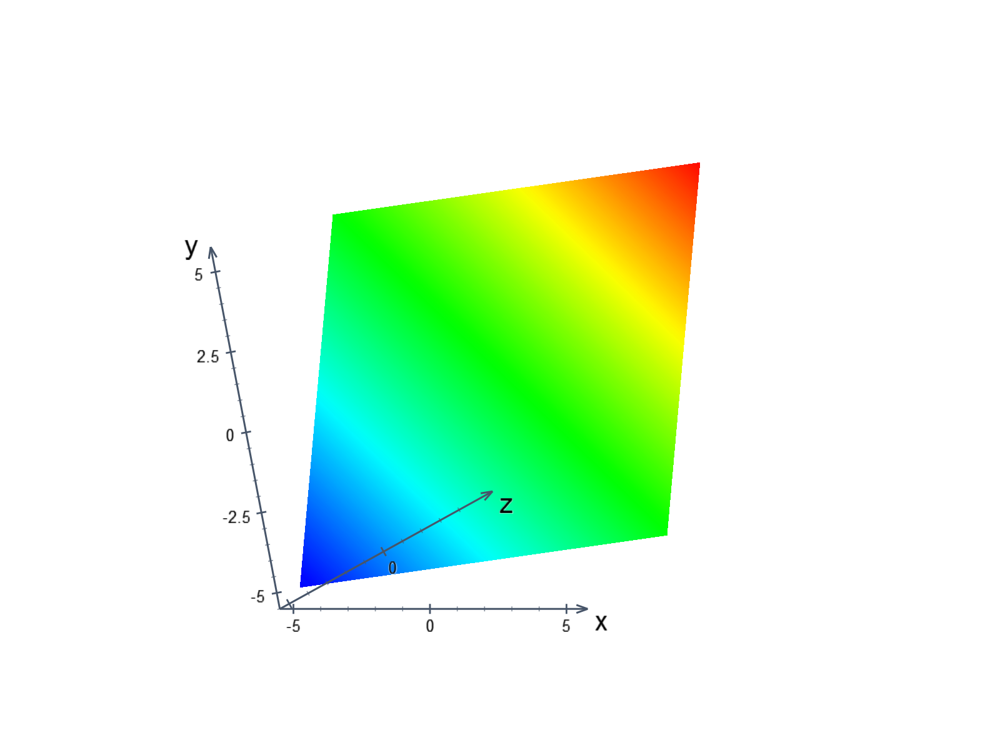
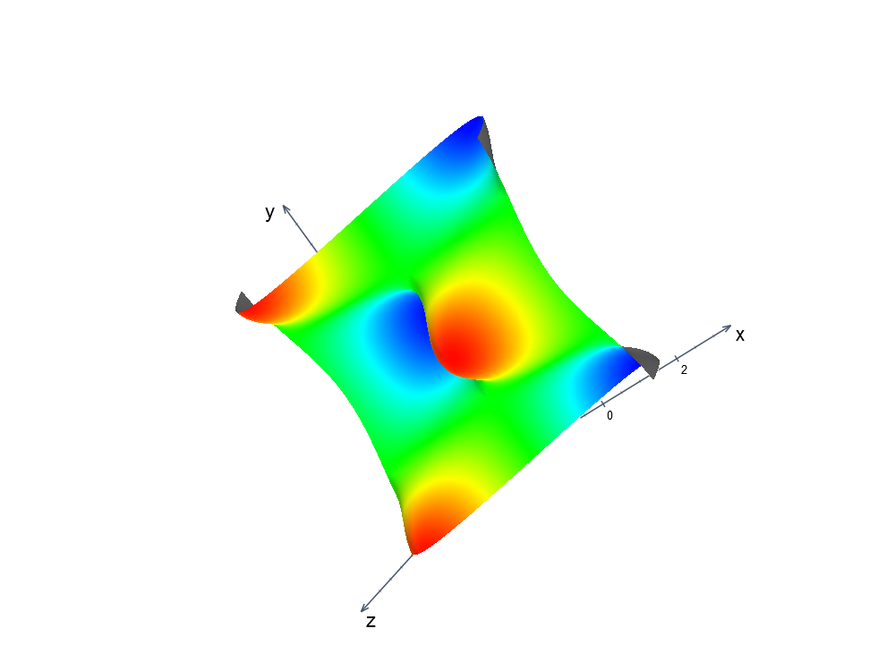
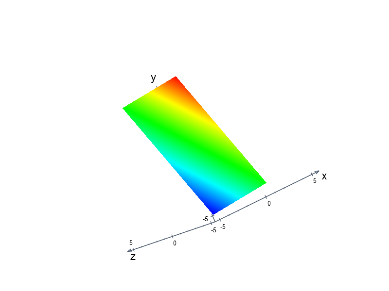

# Depth-aware 3D axis presentation (issue #255)

## Problem

[Issue #255](https://github.com/PawelTroka/Computator.NET/issues/255) shows yellow,
heavily outlined numerical labels and ticks painting over nearer surfaces. The
baseline combines faceted axis cylinders/cones with the surface mesh and its
pseudo-colour material, but paints numerical annotations on a separate WPF
canvas. The canvas previously had no surface-visibility test.

Baseline: `b6b33b13d1e15ec56cbff5f66f1bb0d750854a5b`, after integration #253.
The open PR queue and a dedicated #255 search were checked before modification;
the existing startup, help-popup, and numerical-method PRs do not cover this fix.

## Rendering changes

- Use neutral slate defaults: label RGB `(51,65,85)` and axes RGB `(71,85,105)`.
  Existing custom colour/alpha and font settings remain supported.
- Paint upright numerical labels with native WPF `FormattedText` in display
  formatting and grayscale mode. Geometry remains useful for ink measurement
  and a restrained contrast edge; it no longer supplies the text fill.
- Replace the displayed six-sided cylinders and cones with antialiased
  1.5-DIP axis strokes and small chevrons. Major/minor ticks retain their
  8/4-DIP lengths and 1.4/0.8-DIP thickness hierarchy. These dimensions do not
  become oversized when zooming the plot.
- Build visibility from the **actual plotted triangles** after applying the
  same model matrix as WPF. Decorative axes are excluded from the data mesh.
  The legacy mesh-construction methods retain their default behaviour for
  existing callers; the chart explicitly requests data-only meshes.

## Geometric visibility

The shipped camera is orthographic, positioned at `(0,0,2)`, looking down `-Z`,
with width `2`, near plane `1`, and far plane `10`. Rotation, zoom, and pan live
in `TransformMatrix.m_totalMatrix`. In that coordinate system, larger Z is
closer and the visible depth range is `[-8,1]`.

The portable `ProjectedMeshOcclusion` helper clips triangles against the camera
planes and viewport, then indexes their projected bounds in screen tiles. The
bounds are only an acceleration structure: visibility uses triangle half-planes
and affine depth comparisons, including triangles crossing a camera plane.
Surface backfaces occlude because the production renderer has an opaque back
material; scatter meshes use the production front-face winding.

Each axis or tick is a camera-facing stroke ribbon. Its depth varies along the
axis and is constant across the stroke width. Foreground triangle intersections
produce hidden parameter intervals. Their union is removed before painting.
Where a triangle covers part of a stroke's width, the whole cross-section is
suppressed, including a half-physical-pixel antialias allowance. This conservative
silhouette treatment avoids coloured fringes without sampling the mesh at a
few points or filling holes between disconnected triangles.

Labels are upright billboards at their world anchor's depth. A hidden anchor
suppresses its label. A candidate label position is accepted only when its
**entire ink/contrast-edge rectangle** is clear of nearer geometry, including
triangles wholly contained inside that rectangle. The opposite placement side
may be used when clear; otherwise the complete label is omitted. Partly cut
numerals are deliberately avoided. Axis names also try a position beyond the
arrow and are never automatically shrunk below the numerical font size
(or below the user's explicitly smaller name size).

The scene index is invalidated by changes to the mesh, matrix, viewport, camera
clip planes, or backface policy. Presentation-only edits reuse the index. During
rotation, triangle, tile, and projected-vertex buffers are cleared and repopulated
without allocating another full mesh index each frame.
Requested-size exports create independent annotation layouts and pass the
destination pixels-per-DIP explicitly. Export cleanup releases mesh-change
subscriptions even if rendering fails. Frozen meshes do not need subscriptions.

## Regression coverage

`ProjectedMeshOcclusionTests` runs in both the portable Engine.Tests and native
Desktop.Tests projects. Its expected intersections are analytical. Coverage
includes winding, front/back/coplanar depths, sloped depth crossings, overlapping
and disconnected occluders, subpixel slivers, whole-label intersections,
off-centre stroke coverage, camera/viewport clipping, invalid geometry, and a
124,002-triangle maximum-quality scene.

`Chart3DAxisOcclusionTests` exercises native WPF pixels, partial ticks, displaced
label footprints, mutable/frozen meshes, clipping, rotation/zoom/pan across
planes/saddles/waves/flat surfaces, scatter/custom settings, 96/144/192-DPI
exports, and PNG/BMP round trips. Its independent Möller–Trumbore ray oracle
checks the real scene mesh without calling the production visibility helper.

The existing `Chart3DAxisRenderingTests` retains world-coordinate, culture,
scientific-notation, mixed-scale, collision, visibility, clearing, and export
isolation checks. Its native evidence fixture retains twelve unchanged scene
recipes for comparison and adds occlusion views of different geometries.

### Reproduction

```powershell
dotnet test Computator.NET.Engine.Tests/Computator.NET.Engine.Tests.csproj -c Release --filter ProjectedMeshOcclusionTests
dotnet test Computator.NET.Desktop.Tests/Computator.NET.Desktop.Tests.csproj -c Release --filter "Chart3DAxisRenderingTests|Chart3DAxisOcclusionTests|ProjectedMeshOcclusionTests"
```

The second command requires Windows. The existing Cake Windows validation
workflow runs the complete desktop suite and uploads native PNGs plus their
source/commit/hash manifest in `diagnostics-Computator.NET.Desktop.Tests`, under
`TestResults/chart-axis-rendering/wpf-3d/`.

## Verified native evidence and results

The exact baseline's native before images come from successful Windows run
[40043303079](https://github.com/PawelTroka/Computator.NET/actions/runs/40043303079),
desktop job `120719128219`, artifact `12540865126`. The downloaded ZIP SHA-256 is
`606257e9b632d5268048fc2e925e70b26dfa5ceb8fed1111dffd76588aeb773b`.
The manifest's tested commit and all twelve PNG hashes were verified.

The candidate was tested at head
`b39ae29cac877f5eb7f3ddb0bb5fa904ca504cdc`, using GitHub's test merge
`1ee2f00821c8b3162a293f680ebdb91fcea96e14`. Both have the same tree,
`dd1fe2bf548124192e0911a1f1caf35e8bf2d67f`. The merge's parents are the exact
baseline above and the candidate head. The final evidence commit changes only
this document and its images/provenance; production and test sources match the
verified native run.

| Check | Result |
| --- | --- |
| Complete native Windows Desktop.Tests | **468 passed, 0 failed, 0 skipped** |
| Existing 3D axis rendering cases | **21 passed** |
| New native occlusion and settings/export cases | **19 passed** |
| Analytical projected-triangle geometry cases | **31 passed** locally and on Windows |
| Complete portable Engine.Tests | **882 passed, 0 failed, 0 skipped** locally; cross-platform CI also passed |
| Windows-targeted Release cross-build, SDK 10.0.402 | Passed, zero errors; existing warnings remain |
| Whitespace/diff validation | Passed |

Native run:
[40098522959 / desktop job 120885710574](https://github.com/PawelTroka/Computator.NET/actions/runs/40098522959/job/120885710574).
The native artifact is `12561569494`, with ZIP SHA-256
`71650d10cc79db53cdf6d66516ac2c3b9954b91bec0a6515fa788b09bf017565`.
It contains nineteen production-rendered PNGs, their source/image hashes and
scene recipes, and the complete desktop test report. The committed image subset
and its provenance are listed in [evidence.json](images/issue-255/evidence.json).

The first Windows run exposed two test-capture assumptions: the custom-colour
test sampled an invalidated visual before completing layout, and a binary
alpha threshold was too sensitive to hinted glyph edges at different DPIs.
The corrected tests complete WPF layout before capture and integrate fractional
alpha coverage, retaining the existing DPI ratio bounds and actual dark-ink
assertions. The successful rerun also requires independently verified hidden
axis anchors in a real wave-surface view; unobscured views alone cannot satisfy
that regression.

Visual inspection of that rerun exposed an axis name reduced to roughly 4.6 DIP
beside an occluding plane. The final change adds the forward placement candidate
and readable font-size floor described above. The final 468-pass run includes
a dedicated native pixel regression for that exact view.

### Matched native before/after images

The following pairs use the same formula, camera, dimensions and scene recipe.
The first pair uses the production defaults; the 192-DPI fixture explicitly
sets black text in both versions. Images are copied without retouching.

| Master, 96 DPI | Proposed, 96 DPI |
| --- | --- |
|  |  |

| Master, 192 DPI | Proposed, 192 DPI |
| --- | --- |
|  |  |

### Real surface occlusion

These additional candidate views put axis portions behind the actual plotted
triangles. The visible fragments remain; covered strokes, ticks and labels are
suppressed. They supplement the matched presentation pairs above.





### Interaction cost and limits

A focused local Release measurement used 124,002 triangles, three long axis
ribbons, and 150 tick/point/label query sets. After five warmups, the median of
ten iterations was approximately 18 ms at 800 by 600 and 16 ms at 1600 by 1200
for projection/index rebuilding plus queries. Reused buffers reduced measured
allocation from about 39.8 MiB to 0.13-0.25 MiB per iteration. This measures the
geometry helper, not complete WPF frame time or hardware interaction latency.

Rotation/zoom/pan coverage drives the production view-transform paths in native
WPF tests. Bitmap-DPI tests do not claim a physical multi-monitor transition.
The implementation preserves the shipped orthographic-camera model; it does
not add a perspective-camera feature.
