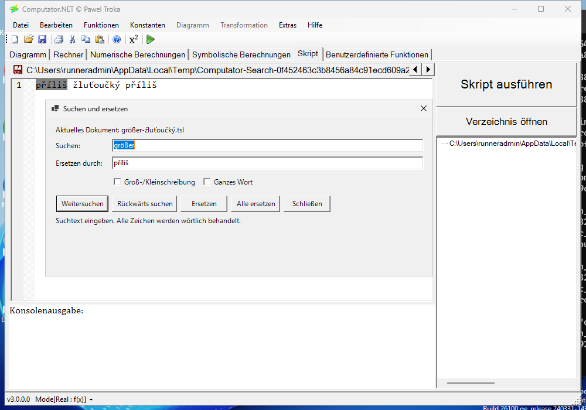
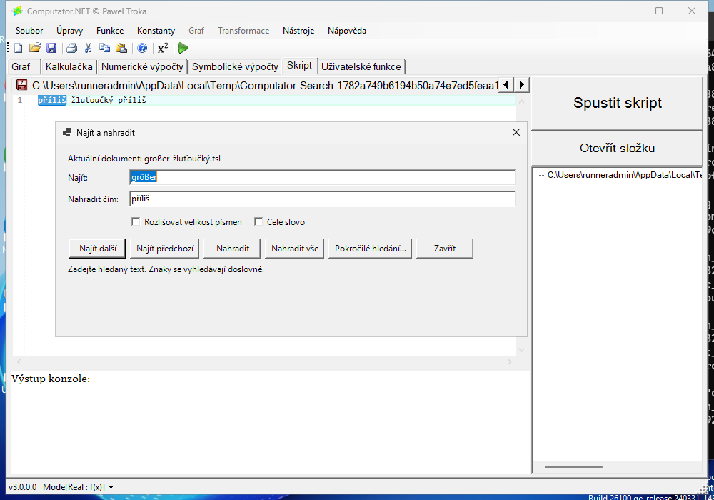

# Computator.NET seven-PR integration validation

## Status

**Validation passed for the exact commits below.** All **21 combined workflows completed successfully**, and all seven current independent PR heads each have **21 successful workflows**. The final merge passes 1,666 portable Engine tests on each of Windows, Linux and macOS, 2,255 Core tests, 588 native Windows desktop tests, and 46 native Mono desktop scenarios. Native GUI execution, German/Czech satellite loading, full-solution builds, mathematical-reference validation and the complete unsigned release-evidence sequence all passed. No unresolved reproducible integration defect was found in this tested matrix after the repairs described below.

No contribution PR has been merged or retargeted. The seven original PRs remain independent drafts against master. Fixes were appended to their existing branches without force pushes, preserving review history.

Temporary validation **PR #312 was closed without merging at 20:00:04 UTC on October 30, 2026**. The final state and CI snapshots were recorded at 20:00 UTC in `results/pull-request-state.json`, `results/ci-workflows.json` and `results/ci-independent-prs.json`. Master remains `fe1aba49b5f9538355ffaaa3d1683f69a23d2d9c`. The isolated integration and evidence branches remain available for review and reproduction.

## Reproducible candidate

| Identity | Commit or tree |
| --- | --- |
| Master base | `fe1aba49b5f9538355ffaaa3d1683f69a23d2d9c` |
| Final candidate head | `f5f1fd0697e0665f56f3d2e4fd516f49860c0497` |
| GitHub CI merge | `a854ee8d9cdd9f598b6c9fe4c00471faf3c5f290` |
| Candidate and CI merge tree | `40cc4713ef0bdb6b49a5cc32fab35b49e17997ce` |

The temporary draft [PR #312](https://github.com/PawelTroka/Computator.NET/pull/312) targets `validation/seven-pr-base-20261030`, pinned at the master base above. Its head is `validation/seven-pr-integration-20261030`. The complete integration contains all seven current contribution heads:

| PR | Contribution | Exact included head |
| --- | --- | --- |
| [#304](https://github.com/PawelTroka/Computator.NET/pull/304) | Numeric-expression power operands | `ceedea70c873ae4e6ac6072f739541ecdcc0d502` |
| [#305](https://github.com/PawelTroka/Computator.NET/pull/305) | Stable secant arithmetic | `d626208fb632834502d4153ec157cc3eec836e95` |
| [#306](https://github.com/PawelTroka/Computator.NET/pull/306) | German/Czech localization and resource-runtime checks | `a8a78e93b37ba516849a5e1cf470286e7cc15c63` |
| [#307](https://github.com/PawelTroka/Computator.NET/pull/307) | Debye supported-order behavior | `05fca5a6bb6f2f7a534825d026b48eb9786a02ce` |
| [#308](https://github.com/PawelTroka/Computator.NET/pull/308) | Trapezoidal finite arithmetic | `0b5c9930d59a4371d62061e27016dc150f4ae608` |
| [#309](https://github.com/PawelTroka/Computator.NET/pull/309) | Euclid utilities, completion and reference | `0ea6da7f804c06b502b174d38a005e9bfcb5de45` |
| [#310](https://github.com/PawelTroka/Computator.NET/pull/310) | Desktop Find/Replace | `7a944e5ba581c95a75a61efe4049804a2c66839e` |

The evidence branch descends from the exact CI merge, retaining that commit for reproduction. Evidence files are outside the tested candidate and the seven contribution branches.

## Reproduced defects and repairs

### Trapezoidal integration: a finite interval could disappear

The original #308 addressed overflow when adding very large endpoint samples. A separate finite-sum path still evaluated the panel width divided by two before multiplying it by the endpoint sum. That ordering loses subnormal interval widths.

For a constant integrand `Math.ScaleB(1, 1022)`, bounds `0` and `double.Epsilon`, and one panel, the exact representable answer is `Math.ScaleB(1, -52)` (approximately `2.220446049250313e-16`). The old path returned zero. Widths of three and five minimum subnormal units also produced substantial relative error.

The appended #308 fix multiplies the full subnormal width by the finite endpoint average, in both the host and complete emitted implementation. Six new host/emitted regression cases failed before the change and pass afterward; they also exercise signs and reversed bounds. The independent #308 Engine suite passed 1,466 tests, including 28 trapezoidal cases.

### Euclid completion: overloads produced duplicate captions

The original #309 had three failed workflows: [native Windows/API validation](https://github.com/PawelTroka/Computator.NET/actions/runs/40979466103/job/123815597956), [real web custom-functions validation](https://github.com/PawelTroka/Computator.NET/actions/runs/40979466154/job/123815597692) and [release evidence](https://github.com/PawelTroka/Computator.NET/actions/runs/40979466211/job/123815597938). At merge `3ba47f734ff7ba9710aca6db1d78b312d45793c6`, their API assertions found 979 unique expression entries out of 983 and 1,323 unique scripting entries out of 1,331. Both Int32 and Int64 overloads were displayed with the alias `integer`, while some collection captions also lost their argument types. Compact excerpts are retained in `results/original-euclid-api-failures.json`.

The appended #309 fix preserves every overload and insertion expression while distinguishing `int` from `integer` and retaining collection element types in Euclid captions. All 37 overloads now have distinct typed captions; the 16 reference lookup keys remain stable. Two Core regression cases cover expression and scripting completion. The reference regeneration changes 11 Euclid articles and leaves all 1,220 non-Euclid articles byte-identical. The corrected independent PR's [reference workflow](https://github.com/PawelTroka/Computator.NET/actions/runs/41105924864/job/124235604493) passed 166 reference tests and 63 authoring tests at merge `535c618e6ec3d714397a8dfe5a7868b9b0ed16c4`.

### Whole-word Find/Replace: enclosing combining marks were excluded

The shared word-boundary classifier omitted `UnicodeCategory.EnclosingMark`. For text represented as `x\u20DD x x\u20E3`, a whole-word search for `x` incorrectly matched all three positions. Only the middle, unadorned `x` should match under the documented combining-mark behavior.

The appended #310 fix includes enclosing marks in word boundaries. All three new portable regressions failed before the change; the corrected portable search suite passes 39 cases. Existing native workflows now check the same boundary on Windows and Mono.

## Localization and desktop integration coverage

The original #306 translations did not exhibit a reproduced production defect. Validation was strengthened to test compiled resource loading rather than only source XML. A shared contract requires exact German and Czech satellite assemblies, checks every translated value against its source resource, and verifies fallback from `de-DE` to `de` and from `cs-CZ` to `cs`.

The portable localization tests also pass the complete source-resource contract: every neutral key has a German/Czech value, nonempty source strings have nonempty localized values, composite-format parameters are preserved and parse correctly, invariant values remain unchanged, menu mnemonic counts and file-filter patterns are preserved, and contact addresses match the neutral resources.

On the combined candidate this covers 16 resource sets and 338 UI strings per language, including the Find/Replace resources introduced by #310. The independent localization PR has 15 sets and 318 strings per language.

Six parameterized Windows test cases passed natively on the final merge, exercising the German and Czech Find/Replace dialogs with each of Scintilla, AvalonEdit and TextEditor. They check translated menus, dialog title, document scope, whole-word controls, replacement button, result count and read-only message. They also perform Unicode replacement, inspect selection, undo the operation and confirm that the disk file was not implicitly saved.

The complete native Windows Find/Replace fixture contains 29 cases. Its wider coverage includes menu and keyboard routing, both editable workspaces, wrapping, UTF-16 selection, literal replacement text, single-step undo/redo, preservation of other dirty tabs, read-only enforcement, document changes and disposal. Native Mono exercises the supported reduced desktop's TextEditor path.

Two issues in the added validation coverage were corrected on #306. First, two new test-support files were missing from the required solution inventory; a two-entry SLNX correction fixed that omission. Second, native Windows CI exposed a resource-comparison mismatch at the multiline `Strings/featuresInclude` value for both languages. The resource compiler preserves CRLF, while the original `XDocument.Load` test helper normalized it to LF. German values were 407 versus 400 characters, and Czech values 362 versus 355, because each contained seven CRLF line endings.

The exact-reader correction uses `XmlTextReader` with normalization disabled and preserves whitespace. It keeps exact compiled-satellite and regional-fallback comparisons; it does not normalize translated output. Real SDK resource builds now verify all 338 German and 338 Czech strings and their fallbacks for both LF and CRLF source layouts. Preserved whitespace/entity fixtures also pass, and deliberate CR-entity, literal-CR, Unicode, leading-space, whitespace-only and CR-only-entity mutations remain rejected. DTD processing is prohibited. All 1,014 real neutral/German/Czech string entries use `xml:space="preserve"`.

These were corrections to the added test coverage, not production translation defects. The final candidate differs from the preceding candidate only in the shared resource-test helper. Relative to the earlier numerical-probe tree, only that helper and the SLNX inventory differ; the mathematical production sources are unchanged.

## Completed local evidence

| Check | Observed result | Source identity |
| --- | --- | --- |
| Full portable Engine Release suite | 1,666 passed; 0 failed; 0 skipped | Final CI merge `a854ee8d...`, tree `40cc4713...` |
| Rebuilt native Mono desktop acceptance | 46 passed; 0 failed; 0 skipped; production startup/render/graceful close passed | Final CI merge `a854ee8d...`, tree `40cc4713...`; includes corrected resource reader |
| Supplemental compiled TSL integration | 30 passed; 0 failed; 0 skipped | Published candidate `189d28c0...`, tree `58b013e7...`; final differs only in SLNX inventory and a resource-test helper |
| Supplemental native Mono mathematics | 116 passed; 0 failed; 0 skipped | Actual net48 Core/Engine snapshot with recorded SHA-256 hashes and source equivalence to final |
| Debye reference-oracle verification | Six constants verified independently | Exact rational Bernoulli series, 60 and 80 terms |

The portable run used SDK 10.0.403 on Linux x64. The native Mono run used Mono 6.8.0.105 on Ubuntu 24.04 with Xvfb, libgdiplus and system GSL. Both resource scenarios verified all 338 German and 338 Czech compiled values and regional fallbacks.

The supplemental .NET fixture combines literal powers, digit-suffixed names, secant roots, trapezoidal integration, Euclid overloads and `out` arguments through actual TSL compilation. Both host-reference and complete emitted-numerics paths are covered, including German/Czech execution cultures. Its packaged reproduction command was also executed successfully.

The 116-check Mono probe covers extreme secant arithmetic, finite and subnormal trapezoidal boundaries, actual combined TSL expressions and Debye across host, emitted, precompiled-expression and precompiled-script surfaces. It uses actual production binaries; the manifest explicitly distinguishes a historical binary snapshot from a fresh build at the final merge. No additional defect was found.

## Final CI evidence

All product-suite observations in this section checked out the final CI merge `a854ee8d9cdd9f598b6c9fe4c00471faf3c5f290`. Counts repeated by separate workflows are confirmations of the same suites, not additional unique tests.

| Validation area | Observed result | Primary evidence |
| --- | --- | --- |
| Portable Engine and published CLI | 1,666 passed, zero failures/skips, plus 39 CLI process checks on **each** of Windows x64, Linux x64 and macOS arm64 | [Portable workflow](https://github.com/PawelTroka/Computator.NET/actions/runs/41113922645) |
| Native Windows Core | 2,255 passed, zero failures/skips; includes 100 Debye cases across four implementations | [Core job](https://github.com/PawelTroka/Computator.NET/actions/runs/41113923142/job/124263106184) |
| Native Windows Core integration | 947 passed, zero failures/skips | [GSL/ABI Windows job](https://github.com/PawelTroka/Computator.NET/actions/runs/41113922944/job/124263105024) |
| Native Windows Desktop | 588 passed, zero failures/skips; 29 Find/Replace cases and two exact resource cases; production startup and normal shutdown | [Desktop job](https://github.com/PawelTroka/Computator.NET/actions/runs/41113923142/job/124263105725) |
| Native Mono desktop | 46 passed, zero failures/skips; supported TextEditor workflow and production startup/rendering/graceful close | [Mono job](https://github.com/PawelTroka/Computator.NET/actions/runs/41113922547/job/124263098930) |
| Mathematical reference | 166 reference tests, 63 Python authoring tests, 10 Node plot-geometry tests; 765 TeX equations, 10 rendered diagrams, 1,236 catalog entries and 1,331 completion items verified | [Reference job](https://github.com/PawelTroka/Computator.NET/actions/runs/41113922917/job/124263106241) |
| API and real browser workflows | 129 API cases passed, one documented 3D-chart skip; 26 custom-function browser cases and 10 browser/API cases passed | [Custom functions](https://github.com/PawelTroka/Computator.NET/actions/runs/41113922554/job/124263099462), [browser/API](https://github.com/PawelTroka/Computator.NET/actions/runs/41113922843/job/124263105634) |
| Complete solution | Debug and Release both build with zero errors and 21 warnings; solution inventory and IDE contracts passed | [Solution workflow](https://github.com/PawelTroka/Computator.NET/actions/runs/41113922609) |

The API skip is the existing `ReturnsHttpOkForChart3D` case: server-side 3D chart rendering is not implemented. It is not a new failure or a silent omission. Synthetic result-guard self-tests also exercise deliberately skipped and rejected fixtures; these are harness checks and are not counted as product-suite results above.

The dedicated [native Windows Desktop job](https://github.com/PawelTroka/Computator.NET/actions/runs/41113923142/job/124263105725) passed **588/588 tests**, including **29 Find/Replace cases** and the **two exact satellite cases**. The downloaded TRX independently confirms all 588 result rows passed, with no failures or unexecuted cases. The production executable passed splash/startup, main-window and normal-shutdown acceptance; its result records `normalShutdown=true` and `forcedTermination=false`.

The diagnostic artifact is `13005448240`, independently verified at SHA-256 `1e1bac5197e4c613b575b11c42b13e30e0cc515d44a7afb022461d98be4bb1f6`. Six preserved screenshots show the combined German/Czech main UI and Find/Replace dialogs in all three supported Windows editors. Their labels and Unicode text are legible with no visible dialog clipping at the captured CI display size. Capturing a screenshot activates the dialog and refreshes its status hint; replacement-count correctness is established by the passing assertion before capture, rather than by the hint shown in the PNG.





The [Windows GSL/ABI job](https://github.com/PawelTroka/Computator.NET/actions/runs/41113922944/job/124263105024) checked out exact merge `a854ee8d9cdd9f598b6c9fe4c00471faf3c5f290` and passed **588/588 native Desktop tests** and **947/947 Core integration tests** on Windows Server 2025. Its log explicitly records all six German/Czech editor cases and both exact satellite tests, each covering 338 compiled strings plus regional fallback. The GSL source/ABI workflow also passed its native ABI probe on Windows x64, Linux x64 and macOS arm64.

The [packaging/coverage job](https://github.com/PawelTroka/Computator.NET/actions/runs/41113922737/job/124263735734) passed **2,255/2,255 Core tests**. Its independently parsed TRX confirms **100/100 Debye cases**, with 25 passing cases on each of the host, generated, precompiled-expression and precompiled-script implementations. These check supported orders, normalized values, zero limits, real-domain restrictions and explicit unsupported-order behavior. The final portable suite separately includes 36 numeric-literal translation cases, 90 secant arithmetic cases, 28 trapezoidal overflow/subnormal cases, 34 Euclid cases and 39 text-search cases; these are subsets of the reported full suites, not additional totals.

The [native Mono CI job](https://github.com/PawelTroka/Computator.NET/actions/runs/41113922547/job/124263098930) checked out exact merge `a854ee8d9cdd9f598b6c9fe4c00471faf3c5f290` and passed **46/46 cases, with zero failures or skips**. Its runtime log confirms all 338 German and 338 Czech compiled values and regional fallbacks, the supported TextEditor Find/Replace workflow, and production startup/rendering/graceful shutdown. Artifact `13004847536` has SHA-256 `280ea7d1c3d5c9b24a11b66521681ef6519f05c0145a1d806fd07ae18e5b69bb`. The artifact XML independently contains 46 successful testcase nodes. The screenshots use the English-default Mono UI; German/Czech resource loading is established by the exact runtime assertions.

The [final release-evidence job](https://github.com/PawelTroka/Computator.NET/actions/runs/41113922938/job/124263100271) also passed, completing the last of the 21 workflows. It verified 27 release-identity contracts and wrote commit-bound evidence for ten test reports and 19 candidate files. Its 242 published-frontend cases use intercepted API fixtures across Chromium and Firefox; the separately reported ten real browser/API cases, 26 custom-function cases and six protected local-web-package cases exercise real-stack behavior. The unsigned MSIX check round-tripped 1,422 files unchanged. These checks establish the tested unsigned candidate and preserve the signing/installation limits below.

All 21 combined runs and all 147 successful runs across the seven independent heads are listed with their exact run URLs in the CI snapshot files. There are no pending or failed workflows for the recorded current heads. Earlier failed or canceled runs belong to superseded revisions and are not substituted for final-commit results.

## Scope and limits

### Reproduce the principal suites

Use a separate checkout of the recorded CI merge, with the repository-pinned .NET SDK 10.0.403 and the prerequisites in its checked-in workflow files. The portable Engine command used for the local final-commit run is:

```bash
dotnet test Computator.NET.Engine.Tests/Computator.NET.Engine.Tests.csproj -c Release -m:1 -nr:false -p:UseSharedCompilation=false
```

On native Windows, the dedicated desktop job executes this PowerShell command:

```powershell
./build.ps1 -Target CI '--suite=Computator.NET.Desktop.Tests'
```

The same `CI` target selects `Computator.NET.Core.Tests`, `Computator.NET.Core.IntegrationTests` or `Computator.NET.WebApi.IntegrationTests` through the `--suite` argument. Native Mono acceptance uses the checked-in Linux harness, with Mono, Xvfb, libgdiplus and GSL installed:

```bash
COMPUTATOR_DOTNET=/path/to/dotnet bash build/mono/validate.sh Release
```

The source and exact commands for the supplemental 30/116 checks are provided separately in `reproduce.sh`; their historical observation identities remain explicit.

### Interpretation

- Validation applies to the exact seven contribution heads and base listed above. Later edits or a changed master require an appropriate new integration check.
- Native Windows behavior is established by execution on Windows Server 2025 x64. A Linux cross-build alone would not establish GUI behavior, and these results are not a claim of testing every supported Windows release or display configuration.
- Native Mono coverage is the supported reduced TextEditor desktop, not Scintilla or AvalonEdit on Mono.
- Debye orders 1 through 6 are supported; unsupported orders return NaN. This work does not implement higher orders.
- Workflow names explicitly distinguish script mirrors, activation contracts and clean-machine harness validation from actual external-service runs or installation acceptance. Their success must not be described as installation certification.

The exact supplemental fixtures, hashes, compact outcomes and reproduction commands are in [README.md](README.md) and [manifest.json](manifest.json). No master merge is authorized or performed.
